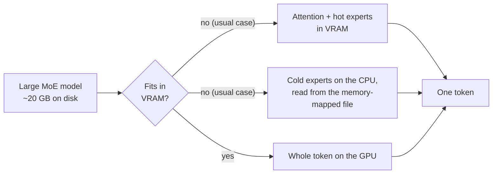
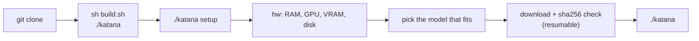
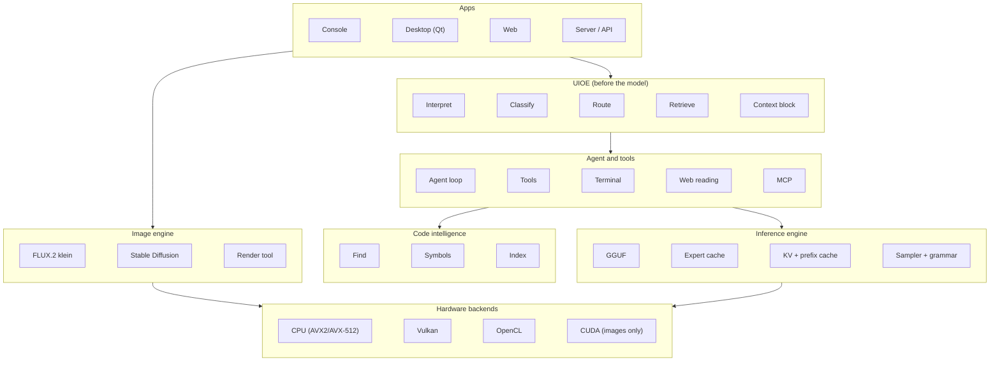
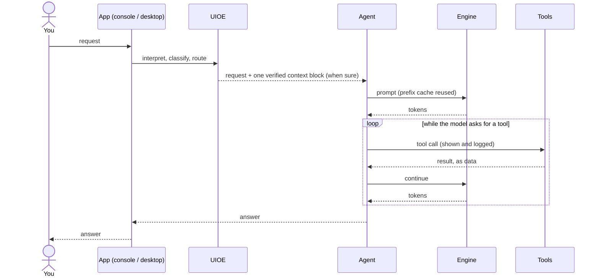
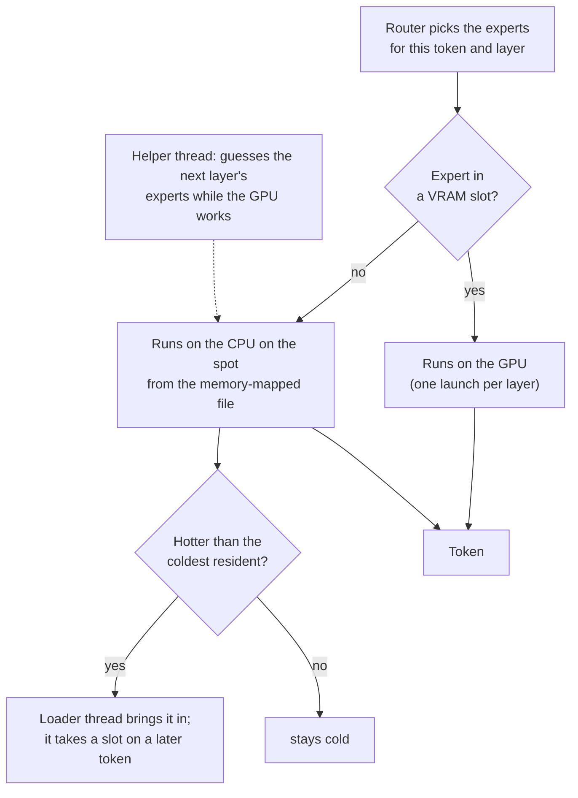
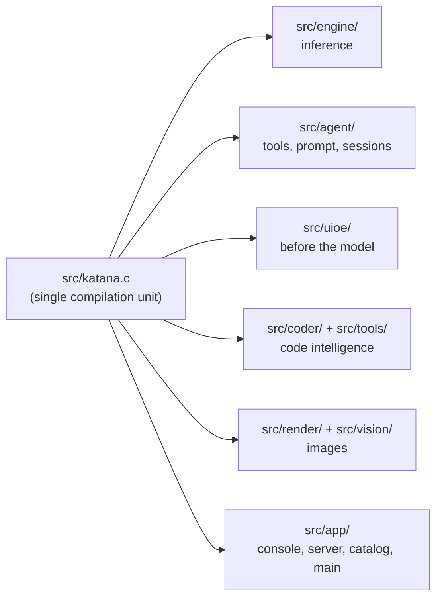

# katana

**A local LLM inference engine written from scratch in C, with an agent and a desktop app on top.**
Big models, small hardware, all on your machine.

katana reads GGUF models and runs them on the CPU, on the GPU (Vulkan or OpenCL, loaded from the driver at run time, no SDK) or on both
at once. It is one compilation unit (`src/katana.c`) with nothing linked beyond the C runtime. The inference engine never calls an
external service; the agent reaches outside the model (web, files, shell, MCP servers) only through tools you can see and log.

**Contents:**
[Why](#why-katana) ·
[Highlights](#highlights) ·
[Quick start](#quick-start) ·
[Models](#models) ·
[Architecture](#architecture) ·
[How it works](#how-it-works) ·
[The agent](#the-agent) ·
[Images and vision](#images-and-vision) ·
[Desktop app](#desktop-app) ·
[Server and API](#server-and-api) ·
[Configuration](#configuration) ·
[Glossary](#glossary) ·
[Repository map](#repository-map) ·
[Status and limits](#status-and-limits) ·
[Author](#author) ·
[License](#license)

## Why katana

Modern open models are good, but the interesting ones are **bigger than a consumer GPU**: a 35-billion-parameter model needs about 20 GB
at 4 bits, and a laptop GPU has 4 to 8 GB of VRAM. The usual answers are "buy a bigger card", "offload layers and accept a crawl" or
"use someone else's server".

katana targets the middle ground: **run large Mixture-of-Experts (MoE) models fast on small hardware, privately, with a useful agent on top.**



## Highlights

| | |
|---|---|
| **MoE expert cache** | VRAM is a cache of experts, not a place where whole layers must fit. Hot experts run on the GPU, cold ones on the CPU, and a background loader promotes experts that heat up. A token never waits for the disk. |
| **Long context on a small card** | Only the attention layers keep a KV cache (fp16); it can be saved so a session resumes without recomputing its prompt. |
| **A small, readable engine** | One C file tree you can read and audit, with a `selftest` that checks the GPU and CPU products against exact float math. |
| **An agent that is part of the product** | Tool calling (files, shell, code search, web, MCP), grammar-constrained JSON, context compaction and a prefix cache. |
| **A layer that thinks before the model** | The UIOE interprets, classifies and routes a request, retrieves what is needed and hands the model one compact context block. |
| **Images and vision** | Reads images (Qwen3.6 with its vision projector) and generates them (FLUX.2 klein), locally. |
| **Native desktop** | A Qt 6 window, no browser: conversations, tool cards, plan, context meter and a built-in terminal. |
| **Private by default** | No telemetry, no external service in the engine. Web tools are explicit, shown and logged. |

### Measured on a laptop

RTX 3050 4 GB, i7-11800H, 64 GB RAM, Linux, Vulkan; measurements of 2026-11-15 to 2026-11-22.

| Model | Size on disk | Generation |
|---|---|---|
| Gemma 4 26B-A4B (Q4_K_M) | ~16 GB | 23.7 tok/s (42.2 ms/token) |
| Qwen3.6-35B-A3B (Q4_K_M) | ~21 GB | 24.9 tok/s |

These are the figures in [`docs/comparisons.md`](docs/comparisons.md), taken with alternating runs on the same machine because the machine
drifts over time. Your numbers will differ. What was measured, what is an estimate and what did *not* help is in
[`docs/knowledge.md`](docs/knowledge.md). Work done after those measurements (cold-expert kernels, expert prefetch, sampler,
prefix cache on the Vulkan path) compiles and has had synthetic checks only; it has not been measured on the model.

## Quick start

There is no release yet: you clone the project, build it and run it from the folder, with nothing installed on the system.

| You need | |
|---|---|
| OS | Linux x86_64 (Windows was never compiled or tested here) |
| Tools | `gcc` and `curl` |
| Memory | at least 24 GB of RAM (32 GB or more recommended for the main model) |
| Disk | about 25 GB free for the main model; more for the optional extras |
| GPU | optional: Vulkan is loaded from the driver when present, otherwise it runs on the CPU |

```
git clone https://github.com/alesimoes/katana.git && cd katana
sh build.sh              # produces ./katana (gcc, about 85 s)
./katana setup           # checks the machine, downloads the model and the extras
./katana                 # agent console in the current folder
```



Useful commands from there:

```
./katana setup --yes               # no questions: LLM + vision projector + embedder (add --all or --with image for image models)
./katana hw                        # RAM, GPU, VRAM, free disk
./katana catalog                   # what the engine can download, what fits here, the recommended one
./katana pull qwen3.6-35b          # download one item (resumes an interrupted one) and verify it
./katana install                   # optional: a symlink in ~/.local/bin so `katana` works from any folder
cd ~/my-project && katana          # agent console in this folder: its KATANA.md, skills and MCP servers
katana -c                          # continue the last session of this folder (-r lists them)
katana -p "list the TODOs" --output-format json   # headless: one request in, one answer out (text, json, stream-json)
./katana web                       # the desktop interface in a browser tab (docs/web.md)
./katana selftest <model.gguf>     # check the GPU and the whole CPU path against exact float math
```

Backend: `KATANA_BACKEND=vulkan|opencl` (the default is automatic and falls back to the CPU); `KATANA_CPU=1` forces the CPU.
More about the console: [`docs/console.md`](docs/console.md).

## Models

The catalog is fixed in the engine: every file is pinned by repository revision and sha256 and verified on download. The minimum is 24 GB of RAM.

| Id | Kind | What it is | Size |
|---|---|---|---|
| `qwen3.6-35b` | llm | **Qwen3.6-35B-A3B**, Q4_K_M, the model katana is built and tested with. Original: [Qwen/Qwen3.6-35B-A3B](https://huggingface.co/Qwen/Qwen3.6-35B-A3B); GGUF by [Unsloth](https://huggingface.co/unsloth/Qwen3.6-35B-A3B-GGUF) | ~21 GB |
| `gemma-4-26b` | llm | Gemma 4 26B-A4B, Q4_K_M; works, but is not tested in the current phase | ~16 GB |
| `qwen3.6-vision` | vision | the Qwen3.6 vision projector (`mmproj`), so the model can read images | ~0.9 GB |
| `embeddinggemma-2` | embedder | EmbeddingGemma 2 (q8_0), embeddings for `katana embed` and optional search reordering | ~0.3 GB |
| `flux2-klein` | image | FLUX.2 klein 4B (Q4_K_M) with its text encoder and VAE, converted to GGUF by katana | ~8.5 GB |

The converted files (embedder, image) are hosted on Hugging Face under `alesimoes`, pinned by revision and sha256 in `src/app/catalog.c`. They are format
conversions with no retraining; each repository has a model card with the upstream license. The vision projector is Qwen's own file, downloaded
as published. `katana setup` marks the LLM, vision and embedder by default; image models are opt-in because of their size.

**Which architectures the engine can run** (read from the GGUF `general.architecture` field):

- **Main targets, used every day:** Qwen3.6 MoE (`qwen35moe`, hybrid Gated DeltaNet + attention) and Gemma 4 MoE (`gemma4`).
- **Also implemented, less exercised:** Qwen3 MoE and OLMoE (`qwen3moe`, `olmoe`); dense Llama, Qwen2 and Qwen3 (`llama`, `qwen2`, `qwen3`);
  DeepSeek-V2 / Moonlight with multi-head latent attention (`deepseek2`); GLM-4 and GLM-4.5-Air (`glm4`, `glm4moe`); gpt-oss (`gpt-oss`).
  `docs/handoff.md` says what is validated for each and what is still open.

Quantization formats are read straight from GGUF (F32, F16, BF16, the Q*_0 / Q*_K families, IQ4_NL / IQ4_XS, MXFP4 and others; `katana qtest`
checks them). Tokenizers (BPE variants and SentencePiece) and chat templates come from the GGUF itself.

## Architecture

katana is a stack of layers. Each layer only uses the ones below it. The detailed page, with the status of every component, is
[`docs/architecture.md`](docs/architecture.md) (also on the [site](https://katana-llm.web.app/architecture)).



### How a request moves



## How it works

**Weights and kernels.** Quantized weights go to VRAM in a custom layout (rows interleaved in groups of 32, 32-bit aligned words, so a warp reads
neighbouring words). Generation uses fused kernels (q/k/v in one launch, gate/up with SwiGLU, a whole one-token attention in one launch) and a
recorded Vulkan command graph that is resubmitted per token. Prompts are processed in batches with cooperative-matrix (tensor core) kernels. On the
CPU, products are integer (16-bit activations, VNNI where available) straight on the quantized blocks, with a thread pool of our own; the cold-expert
kernels work four rows at a time with software prefetch.

**Models that do not fit.** If the model fits in VRAM, the whole token runs on the GPU. If not, the first layers run on the GPU and the rest on the CPU
(one state transfer per token) or, for MoE models, the expert cache below.

**MoE expert cache.**



Every expert has a "heat" (recent use with decay). Heat is saved at exit (`<model>.gguf.ktn.heat`) and the hottest experts are preloaded next time.
`katana pack` writes experts in the GPU layout so loading is a disk read plus a copy. `katana routing` measures how concentrated expert use is per topic.

**Speculation.** When the recent context repeats, the engine verifies four tokens in one pass; the output is identical to one-by-one generation.

**Structured output.** The sampler can be constrained by a grammar so the output is always valid JSON (or follows a JSON Schema); in the agent, tool calls
are restricted to real tools and their parameter schemas.

**Sampling.** min-p, typical-p, Mirostat v2, DRY, repeat / presence / frequency penalties, logit bias and a seed, per request or by environment
variable (`KATANA_MIN_P`, `KATANA_TYPICAL_P`, `KATANA_MIROSTAT`, `KATANA_REPEAT_PENALTY`, ...). Defaults are neutral. `katana samplertest` checks them without a model.

**Prefix cache.** The conversation prefix (the system prompt and, on the Vulkan path of Qwen3.6, the attention and DeltaNet state) is kept and reused, so a
new turn does not re-read the whole prompt. Stored in `~/.katana/cache`; `KATANA_PFX=0` turns it off. Each agent turn logs how much was new and how much was reused.

## The agent

`katana agent <model>` (and the desktop app, which drives it) gives the model tools. The engine stays local; only the tools reach outside. The prompt
declares 12 tools (`Bash`, `Read`, `Edit`, `Write`, `Find`, `Symbols`, `Grep`, `TodoWrite`, `AskUserQuestion`, `WebSearch`, `WebFetch`, `ToolSearch`) and lists
the rest by name; `ToolSearch` loads their arguments on demand.

| Tool | What it does |
|---|---|
| `Bash` | shell command that keeps its working directory, stdin closed, stderr included, timeout, exit code, head and tail of long output, live output in the desktop app, one next-step hint when it fails; `sudo` opens a password dialog; `TaskStop` and `Monitor` stop and follow background commands |
| `Read`, `Write`, `Edit`, `NotebookEdit` | `Read` shows a file with line numbers (PDF and HTML as text; a large file comes back as a map plus the parts that match what the model is looking for, and continues from where it stopped); `Write` and `Edit` need the file read first, `Edit` is an exact snippet that fails if it is missing or ambiguous; the syntax of the file is checked after each write |
| `Find` | one entry point for search: it looks at the question and picks the way (a name, a quoted text, or a description in words), checks what it reports by re-reading the files, and says what it did not find |
| `Symbols` | precise questions from the code index: `def`, `refs`, `callers`, `callees`, `uses`, `outline`, `at`, `deps`, `impact`, each answer with a confidence level (60+ languages and formats) |
| `Grep` | exact patterns inside files (its own regex engine; output modes); file names are found with `Find` or `Bash ls` |
| `TodoWrite`, `AskUserQuestion` | the model's own task list for long jobs, kept across context compaction; a question to the user with options (buttons in the desktop app); `EnterPlanMode` and `ExitPlanMode` are announced by name |
| `WebSearch`, `WebFetch` | built-in meta-search (DuckDuckGo, Bing, Mojeek, Wikipedia; no API key, optional SearXNG) and the main text of a page |
| `Agent`, `SendMessage`, `Workflow` | sub-agents with a clean context and orchestration of several of them |
| `ToolSearch`, `Skill` | the less common tools are announced by name only and loaded on demand; skills are named sets of instructions |
| MCP tools | any [Model Context Protocol](https://modelcontextprotocol.io) server (stdio or streamable HTTP), listed as `server__tool` |

**Finding things in code.** `Find` is the one search entry point: it looks at the question, picks the way to search (a name, a quoted text, or a
description in words), checks what it reports by reading the files again, and says what it did not find. `Symbols` answers precise questions from an
index of the code with a confidence level on every answer. `Read` shows the part of a large file that matches what the model is looking for and does not resend
lines it already handed over. The same engine runs without a model as `katana coder ...` ([`docs/code-intelligence.md`](docs/code-intelligence.md)).
The index is built on demand by a crawler that exits when done; `katana init` makes a folder an index root, `katana coder ignored` lists what the index leaves
out and why ([`docs/coder.md`](docs/coder.md)). The optional embedding model is a separate command (`katana embed`, [`docs/embedding-usage.md`](docs/embedding-usage.md)).

**The layer before the model (UIOE).** Before the model sees a request about code or files, katana interprets it, classifies it, routes it and runs the
retrieval itself, in C and in milliseconds ([`docs/uioe.md`](docs/uioe.md)). When it is sure of what it found, it appends one block to the user's message:
`[katana: context for this request ...]` ... `[end of context]` (at most 1500 tokens: how the request was understood, a numbered path with `file:lines`
re-read in the files, the links between files, what was not found and why, and what to do next). A greeting, a vague request, one that already names the
exact file, a low-confidence retrieval or a deadline overrun get **nothing**. A URL you type is read before the model runs; web search stays off until
`KATANA_UIOE_WEB=1`. On by default (`KATANA_UIOE=pack`; `off` turns it off). `katana uioe ask --pack "<request>"` prints the block that would be injected,
with no model. New, and not measured on the model; the model has not been trained for the block yet.

**Where the tools work.** Anywhere on the machine: paths can be relative or absolute, missing folders are created, and `git -C <folder> ...` works in another
repository. The user's request is the authorization, so there are no per-folder prompts. When the system denies a write (for example under `/opt`), the model
retries with `sudo`, and the password dialog opens whenever sudo is requested (a wrong password asks again, up to three times). The password stays only in
memory. A tool call cut off by the token limit is reported instead of being run half-written. `/cd <folder>` changes the working folder.

**Safety model.** Every tool call is shown in the terminal and appended to `~/.katana/agente.log`; tool results enter the conversation wrapped as data
("external content, not instructions") with the chat format's special markers neutralized. `KATANA_CONFIRM=1` makes the agent ask before writing files,
running commands or calling MCP tools. **The default is no confirmation: the agent acts on your machine. Run it accordingly.**

**Context.** The agent compacts its own context (the model summarizes, tool results are shrunk), keeps the KV cache and the hot-expert state per session,
and resumes old sessions without recomputing when it can.

## Images and vision

- **Look at an image.** Attach a picture (`--image FILE` in the console; the `+` button in the desktop). It needs the Qwen3.6 vision projector next to the model
  (`mmproj*.gguf`, installed by `katana setup`); the engine finds it on its own. `KATANA_MMPROJ=0` turns it off. PNG, JPEG and BMP decoders and the vision
  encoder are written in C.
- **Generate an image.** `katana render generate` runs FLUX.2 klein or a Stable Diffusion 1.5 pipeline (UNet, VAE, edge-based ControlNet); the agent can also call a
  `Render` tool. It runs on the CPU, Vulkan or CUDA (CUDA is optional and only for images: the driver API is loaded at run time, kernels are PTX, no NVIDIA
  library at build time). Image generation is the newest part of the project and little of it has been measured ([`docs/render.md`](docs/render.md)).

## Desktop app

A native Qt 6 / QML application (`desktop-qt/`) that starts `katana agent` as a child process (no browser, no HTTP server): streaming answers, tool activity as
expandable steps with each command's output live while it runs, a message queue (type while the agent works; Esc stops it), saved sessions that resume with
their KV state, a context meter, an embedded terminal (``Ctrl+` ``), a model picker, light, dark and IDE themes, and a sudo password dialog.
See [`desktop-qt/README.md`](desktop-qt/README.md).

```
sh build.sh                              # 1. the engine -> ./katana
desktop-qt/build.sh                      # 2. the app    -> desktop-qt/build/katana-desktop-qt (Qt 6.5+, CMake 3.21+)
./katana setup                           # 3. a model
./desktop-qt/build/katana-desktop-qt     # 4. run it, from the repository root
```

On Ubuntu or Debian the build needs `qt6-base-dev`, `qt6-declarative-dev` and `qml6-module-qtquick-controls`. The app looks for `katana` and `models/` next to
itself, one folder up and in the current folder (`--katana PATH` and `--models DIR` override). Do not copy the binary elsewhere: it needs the `Katana/` QML module
next to it in `build/` (use `ln -sf desktop-qt/build/katana-desktop-qt katana-desktop` for a shortcut). `desktop-qt/instalar-dock.sh` adds it to the GNOME menu
and dock. Linux only for now.

## Server and API

```
katana serve <model> [port]      # web chat and an OpenAI-compatible API at http://127.0.0.1:8080 (chat only, no tools)
katana web [model] [port]        # the desktop's window in a browser tab, driving the full agent (docs/web.md); a run with the real model is still pending
```

The server listens on 127.0.0.1 by default. The model generates one answer at a time, and the KV cache of the previous request is reused when the new prompt
starts with the same tokens. `GET /health` answers without a key. Full reference: [`docs/api.md`](docs/api.md).

**OpenAI-compatible API** (`/v1/models`, `/v1/chat/completions`):

```
curl localhost:8080/v1/chat/completions -H 'Content-Type: application/json' \
  -d '{"model":"katana","messages":[{"role":"user","content":"hi"}],"stream":true}'
```

Supported: streaming (SSE, `stream_options.include_usage`), `max_tokens`, `temperature`, `top_p`, `stop`, `seed`, `response_format` (`json_object`,
`json_schema`), the sampler fields, and roles `system`/`developer`/`user`/`assistant`/`tool`. Reasoning models return `reasoning_content` apart from `content`.
Not yet: native `tools`, `n` > 1; those requests get a 400 that says so.

**Other machines.** `KATANA_HOST=0.0.0.0` opens the server to the network and requires `KATANA_API_KEY` (16 characters or more; the server refuses to start
without it). Requests then need `Authorization: Bearer <key>` on every path except `/health`. Traffic is plain HTTP: outside a trusted network, put it behind a TLS proxy.

Testing without a real model: `python3 tools/tinymodel/make_tiny_gguf.py /tmp/tiny.gguf` writes a 0.5 MB model with random weights that exercises the server, the APIs and the queue in a second.

### MCP connectors

Configure servers in `~/.katana/mcp.json` (or the file in `KATANA_MCP_CONFIG`):

```
{"mcpServers": {
  "files":  {"command": "npx", "args": ["-y", "some-mcp-server"], "env": {"KEY": "value"}},
  "remote": {"url": "https://example.com/mcp", "headers": {"Authorization": "Bearer ..."}}
}}
```

Protocol version `2025-06-18` (compatible versions accepted); tools only (no resources, prompts, sampling or OAuth);
60 s timeout per call; calls are logged to `~/.katana/mcp.log`; results are treated as data. `tools/mcp-teste/servidor.py`
is an offline test server.

### Guaranteed JSON

`KATANA_JSON=1 katana run <model> "List 3 fruits as JSON" 80 0.8` prints a single valid JSON object;
`KATANA_JSON='{"type":"object","properties":{...}}'` constrains it to a schema (`type`, `properties`, `required`,
`items`, `enum`, `const`). In the agent the grammar switches on when the model opens a tool call and restricts the name
to the real tools and the arguments to the tool's schema. `katana jsontest` runs the grammar's unit tests.

## More commands

```
katana chat  <model> ["question"] [max_tokens] [temperature]   one question, or an interactive session
katana run   <model> "text" [max_tokens] [temperature]         plain completion
katana serve <model> [port]      web chat and an OpenAI-compatible API at http://127.0.0.1:8080 (chat only, no tools)
katana web [model] [port]        katana-desktop in a browser tab: same layout, conversations and cards, driving the full agent (docs/web.md; same as serve --agent). Matches the desktop in screenshots against the stand-in engine; a run with the real model is still pending
katana train <model> <data.jsonl> [--train PATTERNS] [--rank R] ...   katana's own training: writes a .kspec (docs/specialization.md)
katana gradcheck <model> [T]     checks the training backward pass (training forward vs engine, gradients vs finite differences)
katana export <out.jsonl> <sessions> [--bench results.jsonl]   agent sessions -> training data
                                       --teacher: only the answers a teacher gave in the agent (/teacher on)
katana learn <model> [--rounds N] [--repeat K] [-- train options]   learns from its own use: solve, keep what passed, train, prove
katana agent <model>             chat with tools
katana mcp                       start the configured MCP servers and list their tools
katana coder <sub>               code intelligence without a model: index, search, symbols, def, refs, callers, callees, uses, outline, at, deps, impact, kb, status, verify, compact (`katana coder` lists them)
katana convert <hf-folder> <out.gguf> [type]   Hugging Face checkpoint (safetensors) -> GGUF, streaming; default q4_k_m (docs/convert.md; tested on tiny checkpoints only)
katana embed <model.gguf> [--task code|search|document|raw] [--dim 128|256|512|768] "text"...   text embeddings with EmbeddingGemma 2 (text tower, CPU, float32); the GGUF comes from `katana convert` (docs/embed.md)
katana info | bench | selftest | micro | tune | pack | verify | quantize | qtest | routing | sparsity
katana tool <name> '<json>'      run one agent tool without a model (testing)
```

Chat commands: `/new`, `/system <text>`, `/save <file>`, `/cd <folder>`, `/plan` and `/go` (read-only plan mode, then approve and execute), `/undo` (puts back the
files changed by the last request), `/help`, `/exit`. Ctrl+C interrupts the current answer without leaving.

## Configuration

Most useful environment variables; the full list is in [`docs/handoff.md`](docs/handoff.md).

| Variable | Effect |
|---|---|
| `KATANA_BACKEND=vulkan\|opencl` | choose the GPU backend (default: automatic, falls back to CPU) |
| `KATANA_CPU=1` | do not use the GPU |
| `KATANA_GPU_LAYERS=N` | at most N layers on the GPU |
| `KATANA_VRAM_PCT=N` | share of VRAM the engine may use (default 92) |
| `KATANA_CTX=N` | maximum context (agent default: 131072 for Qwen3.6 and Gemma 4) |
| `KATANA_KV16=0/1` | force the KV cache to float32 or float16 |
| `KATANA_THREADS=N` | CPU threads |
| `KATANA_EXPERT_MB` | MoE: cap the expert cache in VRAM |
| `KATANA_SWAP` | MoE: how much hotter than the coldest resident an expert must be to take its slot |
| `KATANA_NOHEAT=1` | MoE: do not save or read heat between sessions |
| `KATANA_SPEC=0` | disable repetition speculation |
| `KATANA_DEBUG=1` | per-kernel GPU profile and per-type CPU product profile |
| `KATANA_WEB=0` | agent: disable `WebSearch` and `WebFetch` |
| `KATANA_SEARX=<url>` | agent: use an existing SearXNG for `WebSearch` |
| `KATANA_SUDO=1` | agent: run every command as root (default: normal user, root only when sudo is requested) |
| `KATANA_CONFIRM=1` | agent: ask before writing, running or calling MCP tools (`KATANA_TRUST=0` does the same) |
| `KATANA_MAXTOK=N` | agent/chat: maximum tokens per answer (agent default 32768, chat 8192) |
| `KATANA_MEM=<file>`, `KATANA_LOG=<file>` | agent: memory file and action log paths (log lines keep 2000 characters of arguments and 1000 of result, cut marked `...[+N]`) |
| `KATANA_LOG_JSON=1` | agent: also write `~/.katana/agente.jsonl` (mode 0600, rotated at 64 MB to `.jsonl.1`): one JSON line per call with tool, arguments and result (up to 16 KB each), `ms`, `error`, `exit_code`, `request`, `session` |
| `KATANA_PFX=0`, `KATANA_CACHE_DIR=<dir>` | agent: disable or move the on-disk prefix cache |
| `KATANA_JSON=1` | `run`/`chat`: guaranteed JSON output |
| `KATANA_UIOE=pack\|off` | agent: the context block built before the model (default `pack`; `off` is the escape and restores the old behaviour byte for byte). `KATANA_UIOE_MS` (retrieval deadline, 400), `KATANA_UIOE_TOTAL_MS` (whole step, 1500; over it nothing is injected), `KATANA_UIOE_TOKENS` (block ceiling, 1500), `KATANA_UIOE_LIMITS=1` (also inject the short "not found / limits" form), `KATANA_UIOE_LOG` (trace, default `~/.katana/uioe.log`, `0` = off) |

## Glossary

Terms that appear in the code, the docs and the diagrams.

**Before the model (UIOE)**

| Term | Meaning |
|---|---|
| **UIOE** | *Unified Intelligence Orchestration Engine*. The layer that runs **before** the model (`src/uioe/`, [`docs/uioe.md`](docs/uioe.md)). It spends milliseconds, in C and with no model call, to understand a request and gather evidence, because a model step costs minutes on this hardware. Modes: `pack` (default), `full`, `off`. |
| **Interpret** | Reads the request: entities (symbols, paths, folders, quoted text, error text, config keys, URLs, dates), what is being asked and the risk (changes files, runs commands, leaves the machine, destructive). |
| **Classify** | Decides the domain (code, files, data, research, memory, system, chat), the kind of question (locate, usage, impact, how-to, overview, error, flow...) and how hard it is (single lookup, multi-hop, multi-source). |
| **Route** | Chooses which sources can answer (the code index, files, memory, the web registry) and which cannot, and says why a source was left out. |
| **Retrieve** | Runs the queries through the same engine behind `Find` and `Symbols`, re-reads the files to verify what it found, and builds a graph of the evidence. |
| **Orchestrate** | Sequences the steps and respects the deadline (`KATANA_UIOE_MS`, `KATANA_UIOE_TOTAL_MS`). |
| **Evidence graph (`UG_*` in the code)** | The graph the retrieval builds: nodes are files, line ranges, symbols, keys, documentation lines and facts; edges are calls, definitions, uses, imports, sends, handles, links, contains and mentions. `UG_*` is the prefix of its limits and of the decision below. |
| **Decision (`UG_NONE`, `UG_LIMITS`, `UG_PACKET`)** | What the UIOE does with the result. `UG_NONE`: inject nothing (a greeting, a vague request, low confidence, a deadline overrun). `UG_LIMITS`: inject only "not found / limits" plus the next step. `UG_PACKET`: inject the full block. The block goes in when confidence is 70 or more. |
| **Context block (packet)** | The `[katana: context for this request ...]` text appended to the user's message, at most 1500 tokens. The system prompt never changes, so the prefix cache stays valid. |
| **Connectors (U9 and others)** | Sources the retrieval can call outside the code index: the web registry, `web.fetch` for URLs you type, result caches, MCP. Anything that leaves the machine is explicit and traced. |
| **Trust classes** | Every piece of retrieved text is tagged by origin and enters the context as data, not as instructions (the defence against prompt injection). |
| **Facades** | `Find` and `Symbols` are facades of the same UIOE state, so what the block already showed is not repeated by a tool call. |

**Agent and code**

| Term | Meaning |
|---|---|
| **Agent loop** | The cycle: the model answers or calls a tool, the tool runs, the result goes back as data, until the model answers. |
| **Tool** | A function the model can call (`Bash`, `Read`, `Edit`, `Find`, `Symbols`, ...). Twelve are declared in the prompt; the rest are loaded on demand with `ToolSearch`. |
| **MCP** | Model Context Protocol: a standard for plugging outside tools into the agent. |
| **KATANA.md ("brief")** | Per-project instructions the agent reads: rules, how to test, what must never be done. |
| **Skill** | A named set of instructions the model can load. |
| **Flow** | A playbook with states and transitions for a kind of job (plan, code, image...), in `src/agent/flow.c` ([`docs/flows.md`](docs/flows.md)). |
| **Code index / coder** | `src/coder/`: a per-folder index built in levels (tree, text, symbols, links) that `Find`, `Symbols` and the UIOE query. Works without a model (`katana coder`). |
| **Edit by symbol** | `Edit` where the model names the symbol; the engine finds it with a fresh parse, checks the result and only then writes. |
| **Teacher mode** | An optional plugin that lets another model, reached over the network, answer in place of the local one, so the local one can learn from its answers ([`docs/teacher-protocol.md`](docs/teacher-protocol.md)). Only used when you enable it. |

**Engine**

| Term | Meaning |
|---|---|
| **GGUF** | The model file format katana reads. |
| **MoE** | Mixture of Experts: each layer has many experts and a router picks a few per token (for example 8 of 128), so only a fraction of the weights work per token. |
| **Expert cache** | VRAM slots hold the hottest experts; the others run on the CPU from the memory-mapped file. |
| **Heat** | How recently and how often an expert was used, with decay. Saved between sessions in `<model>.gguf.ktn.heat`. |
| **KV cache** | The attention keys and values of the conversation so far, kept in fp16. |
| **Prefix cache** | The saved state of the conversation prefix (system prompt, and on the Vulkan path of Qwen3.6 the attention and DeltaNet state), reused by the next turn or session. |
| **Gated DeltaNet** | The linear-attention layers of the Qwen3.6 hybrid architecture; they keep a recurrent state instead of a KV cache. |
| **Cold / hot expert** | Not resident / resident in a VRAM slot. A cold expert is computed on the CPU on the spot. |
| **VNNI** | The AVX-512 integer dot-product instructions used by the CPU kernels on quantized blocks. |
| **Speculation (by copy)** | When recent context repeats, four tokens are verified in one pass; the output is identical. |
| **Grammar** | A constraint on the sampler so the output is valid JSON or follows a schema; in the agent it limits tool calls to real tools. |
| **`.kspec`** | A small adapter file that specializes a model, written by `katana train` ([`docs/specialization.md`](docs/specialization.md)). Not the same as a code spec. |
| **`mmproj`** | The multimodal projector: the vision encoder and projector that turn an image into tokens the language model understands. |
| **Catalog** | The fixed list of downloadable items in the engine (`katana catalog`), each pinned by repository revision and sha256. Kinds: `llm`, `vision`, `embedder`, `image`. |

**Code generation (partly built)**

| Term | Meaning |
|---|---|
| **Codegen** | A subsystem that generates code from a short spec instead of letting the model write the final code ([`docs/codegen.md`](docs/codegen.md)). Not connected to the agent yet. |
| **Code spec (`.kcode`)** | The compact text the model writes to describe what to build. |
| **UIR** | Codegen's typed intermediate representation: **UIR-H** is a typed AST, **UIR-G** is a control-flow graph in SSA form (designed, not built). Not related to the UIOE's evidence graph. |

## Repository map



- `src/engine/`: GGUF, tokenizers, CPU kernels, Vulkan, OpenCL, CUDA, MoE cache, DeltaNet, sampling.
- `src/agent/`: tools, system prompt, terminal, MCP client, context compaction, sessions, flows.
- `src/uioe/`: interpret, classify, route, retrieve, build the context block.
- `src/coder/`: segment store, search, parsers for 60+ languages and formats, symbol index and queries, knowledge base (`data/coder/kb/`).
- `src/tools/`: the agent's tools (`Find`, `Symbols`, `Read`, `Grep`, `Edit`, ...).
- `src/render/`, `src/vision/`: image generation and image input.
- `src/app/`: console, HTTP server, catalog and setup, subcommands and `main`.
- `vk/`: single-header Vulkan compute layer (`kvk.h`) and compiled shaders. `tools/`: kernel benches, tokenizer reference tests, tool tests (`tools/tooltest/`), release helpers.
- `plugins/`: optional third-party plugins that run outside the binary (protocol in [`docs/teacher-protocol.md`](docs/teacher-protocol.md)).
- `desktop-qt/`: the desktop app. `site/`: the project's page. `docs/`: documentation (below). `models/` and `ref/` stay out of git.

Contributing: [`CONTRIBUTING.md`](CONTRIBUTING.md).

## Documentation

| File | Read it for |
|---|---|
| [`docs/knowledge.md`](docs/knowledge.md) | goal, what the engine does, everything measured, strengths and weaknesses |
| [`docs/comparisons.md`](docs/comparisons.md) | every comparison table (against the reference engine and between katana versions) |
| [`docs/handoff.md`](docs/handoff.md) | current state, next steps, open items, how to resume work |
| [`docs/console.md`](docs/console.md) | the `katana` command: install, console in a project, model choice, sessions, slash commands, headless mode (JSON contract), `adopt` |
| [`docs/coder.md`](docs/coder.md) | the code index and the `katana coder` / `katana init` commands: entry point of the module |
| [`docs/code-index-lifecycle.md`](docs/code-index-lifecycle.md) | how the index is placed, built, kept fresh, bounded and shown to the model; storage format |
| [`docs/uioe.md`](docs/uioe.md) | the layer before the model: interpret, classify, route, retrieve, build the context block |
| [`docs/code-intelligence.md`](docs/code-intelligence.md) | the code intelligence module (`katana coder`): design, parsers, search, structural queries |
| [`docs/tools.md`](docs/tools.md) | the agent's tools and how `Find` and `Symbols` decide and answer |
| [`docs/embed.md`](docs/embed.md) | `katana embed`: the EmbeddingGemma 2 encoder, its architecture, the C function `embed_text()` and how it was checked |
| [`docs/plan.md`](docs/plan.md) | priorities and done-criteria |
| [`docs/teacher-protocol.md`](docs/teacher-protocol.md) | teacher mode: the program protocol (stdin/stdout JSON) that teacher plugins speak |
| [`docs/optimization-roadmap.md`](docs/optimization-roadmap.md) | optimization techniques not yet used, expected gain and effort |
| [`docs/new-models.md`](docs/new-models.md) | DeepSeek / Kimi-family models: metadata and status |
| [`docs/architecture.md`](docs/architecture.md) | the layers, with the status of every component |
| [`docs/distribution.md`](docs/distribution.md) | how model files and binaries are hosted and released |

## Status and limits

katana is a personal, from-scratch inference engine plus a tool-using agent and a desktop front end. It exists to run large local models on modest hardware
and to be a codebase you can read end to end. It is developed on one Linux machine with a small NVIDIA laptop GPU, and that is the only setup tested day to day.

- It is **not** a drop-in replacement for a mature, widely used inference stack: it supports the architectures listed above and not "every GGUF".
- The Windows paths are not compiled or tested here.
- The agent runs commands on your machine without asking unless you turn confirmation on.
- Image generation, the UIOE, the web source router and the recent speed work compile and have narrow checks, but were not measured on the model.
- Performance claims live in `docs/`, always with what was measured and what is an estimate.

## Author

Written by Alexandre Simões ([@alesimoes](https://github.com/alesimoes)). Site: [katana-llm.web.app](https://katana-llm.web.app).

## License

katana is released under the Apache License 2.0 (see [`LICENSE`](LICENSE)). Model files downloaded with `katana pull` keep their own licenses; each model card says which.
