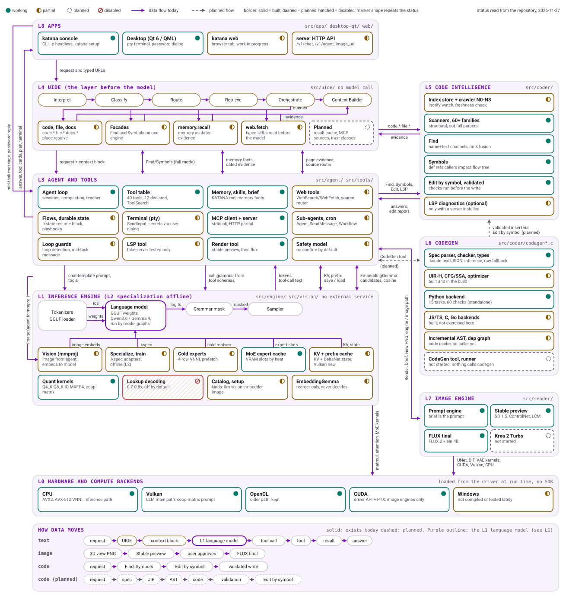

# katana: architecture

Nine layers, from the hardware up to the apps, with the status the repository supports for each component. Nothing here is a new measurement.

Bottom to top: each layer builds on the ones below it. L2 (offline training), L6 (codegen) and L7 (images) are side subsystems, not part of a normal text request.

Status: **working** (built, and a recorded test or measurement shows it doing its job; it may never have run with the real model), **partial** (built but not measured, not run with the real model, or limited), **planned** (designed, not built), **disabled** (built, measured, switched off).

## Layers

### L0. Hardware and backends

Where the numbers get crunched. One backend is chosen at start and the CPU is always the fallback. GPU libraries come from the driver at run time; nothing is linked beyond the C runtime.

Components: CPU (working), Vulkan (working), OpenCL (working), CUDA (optional) (working).

Code: `src/engine/ (cpu_*, vk_*, cu_*), vk/`

CUDA is used by the image engine only; the language model runs on Vulkan, OpenCL or the CPU.

### L1. Inference engine

Reads a GGUF model and produces tokens, with no external service. Delivers a fast, checkable text generator to the layers above.

Components: GGUF models (working), Expert cache (working), KV + prefix (working), Grammar (partial), Draft by copy (disabled).

Code: `src/engine/, src/vision/`

Draft by copy is built and switched off. Image input (vision) exists as a test command and is not part of this audit.

### L2. Specialization

Offline, never in the request path: trains small adapters (.kspec) that adapt a model to katana's tools and conventions.

Components: Specialize (partial), Training (partial), .kspec files (partial).

Code: `src/app/ (specialize, train*, curriculum)`

Built and tried on tiny models only; no training data in the repository and no real training run.

### L3. Agent and tools

The loop that lets the model act: it calls tools, sees the results and goes on until it answers. Delivers an assistant that works on your machine.

Components: Agent loop (working), Tools (working), Terminal (partial), Web reading (partial), MCP (partial).

Code: `src/agent/, src/tools/`

Also here: sessions and context compaction, memory, a note for repeated failures, and sending a message in the middle of a task. Commands run in a pseudo-terminal; when a program asks something, the answer comes from the model or, if it does not know, from the user, and secrets never pass through the model. Web reading uses a registry of sources and says whether each page came complete, partial or blocked. The terminal, the web router and the mid-task message are new: they compile and have had narrow checks, not measured.

### L4. UIOE

The layer before the model. In C, with no model call, it looks at the request and may attach one block of verified context. Greetings and exact requests get no block.

Components: Interpret (partial), Classify (partial), Route (partial), Retrieve (partial), Context block (partial).

Code: `src/uioe/`

Built and checked by hand; whether it improves the real model's answers is not measured.

### L5. Code intelligence

A per-folder index of the code and the tools that query it. Delivers answers that say how sure they are and what they did not find.

Components: Find (working), Symbols (working), Index (partial), Edit by symbol (working).

Code: `src/coder/, src/tools/ (find, symbols, edit)`

Working in tool tests; never timed on a large real tree and not run with the real model.

### L6. Codegen

Generates code from a short spec instead of letting the model write the final code. Built and tested on its own; not connected to the agent yet.

Components: Spec to code (working), Backends (working), Agent tool (planned).

Code: `src/coder/ (codegen*)`

No model has written a spec yet.

### L7. Image engine

Local image generation: a fast preview, then a final image once the user approves. Runs on the CPU, Vulkan or CUDA.

Components: Stable Diffusion (working), ControlNet (working), FLUX.2 klein (working), Render tool (working).

Code: `src/render/, tools/cuda/`

Sharing the small GPU between the agent and FLUX is an open problem; the prompt quality is not evaluated.

### L8. Apps

What the user touches. All of them drive the same agent.

Components: Console (working), Desktop (Qt) (working), Web (partial), Server / API (partial).

Code: `src/app/, desktop-qt/, web/`

The desktop runs on Linux only. The web app and the server were checked against stand-in engines, not the real model.

## How a request moves

1. You type in an app (console, desktop, web or the API).
2. The UIOE looks at the request and, when it helps, attaches a block of verified context.
3. The agent builds the prompt and sends it to the model.
4. The engine runs the model on the GPU or the CPU and produces tokens.
5. If the model asks for a tool (shell, files, code search, web), the agent runs it and feeds the result back, until the model answers.
6. The answer goes back to the app. Image requests go through the Render tool; code generation is not part of this path yet.

## Terms

- **GGUF**: The model file format katana reads.
- **Mixture of experts (MoE)**: A model that uses only a few of its many experts for each token.
- **Expert cache**: Hot experts live in GPU memory; cold ones run on the CPU.
- **KV cache**: The model's memory of the conversation so far; it can be saved to disk.
- **Prefix cache**: The saved state of the system prompt, reused by the next session.
- **UIOE**: The layer before the model: interpret, classify, route, retrieve, build context.
- **Code index**: A per-folder index that Find and Symbols query.
- **Codegen**: Code generated from a short spec.
- **.kspec**: A small adapter file that specializes a model.
- **MCP**: Model Context Protocol: a way to plug outside tools into the agent.

## What this audit could not verify

- Nothing here was measured again. Numbers elsewhere on the site come from the repository's documents, taken on one machine (RTX 3050 Laptop 4 GB, Linux).
- The engine was not rebuilt and the tests were not run for this page. Status comes from the code present and the checks the documents record.
- Whether the UIOE, the tool set or the index improves the real model's answers is unknown; no measurement with Qwen3.6 is recorded.
- The terminal, the web source router and the mid-task message are new today: they compile and have had narrow checks, nothing more.
- Windows was not built or tested after the recent work. The Specialization and Codegen layers were judged from code and notes only.
- Some older notes still carry stale status lines (for example the code-index design note and the embedding notes).
